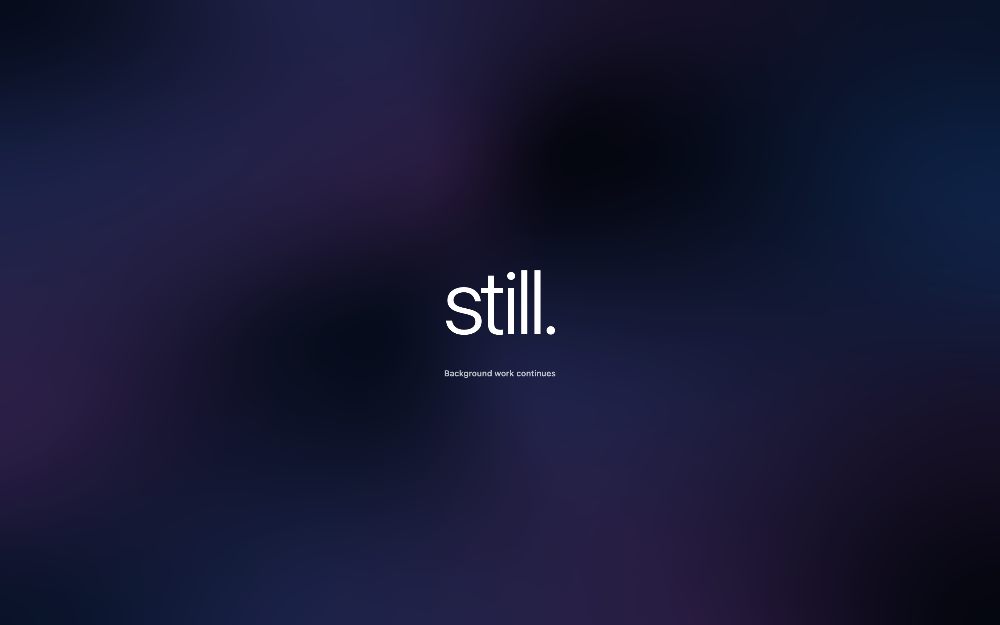

<p align="center">
  
</p>

<h1 align="center">still</h1>

<p align="center"><strong>More time for work. Normal sleep stays in control.</strong></p>

<p align="center">
  Still is a lightweight native macOS menu bar utility that helps selected streaming sessions<br>
  and long-running tasks continue while you need them.
</p>

<p align="center">
  
</p>

## Still 2.0 Release Candidate

Version **2.0.0 RC 2 (build 7)** combines Still Focus, Automatic/Light/Dark appearances, native Icon Composer artwork, onboarding and recoverable installation with the latest sleep and notification fixes:

- Process-owned idle-sleep assertions replace global sleep overrides, with a three-hour ceiling, at least a 15% battery floor and release on crash. Sleep and lock interruptions require an explicit resume.
- Focus exits immediately with Escape while Still has keyboard focus, or with a click on its background. Its windows stay below the menu bar and allow native banners while Still is in the foreground.
- Native agent notifications are an explicit opt-in. Build 7 requests alert/sound permission while preserving other and future Focus preferences; diagnostics report alert style. macOS controls actual delivery.

See [build 7 validation](Docs/RELEASE-CANDIDATE.md), [power safety](Docs/POWER-SAFETY.md), [distribution audit](Docs/DISTRIBUTION-AUDIT.md) and [privacy](Docs/PRIVACY.md). The public source release does not include a notarized installer or a sandboxed Mac App Store build.

## Download

A notarized release is not available yet. Until it is, build Still from source; it takes about a minute. See [Build from source](#build-from-source).

Releases will appear on the [Releases page](../../releases) once the app is signed with a Developer ID and notarized by Apple.

## Features

- **Streaming continuity.** Detects Safari audio playback and prevents idle system sleep during a selected session. If WebKit pauses playback on the lid transition, Still can send a single Play key press to resume it.
- **AI coding-agent sessions.** Stays active while [Claude Code](https://claude.com/claude-code) or [Codex](https://github.com/openai/codex) is writing to its local session files.
- **Manual mode.** One click to keep the Mac active, with a Safety Timeout (3 hours by default).
- **Safety Timeout.** Manual sessions end on their own. All sessions have a three-hour safety ceiling; longer saved timeout preferences are retained but capped at runtime.
- **Battery and thermal safeguards.** Normal sleep is restored below 15% battery or your higher chosen level, under thermal pressure, and in Low Power Mode.
- **Still Ambient.** Midnight, Aurora and Monochrome native mesh animations, with an optional clock and persistent agent attention. Motion adapts to power, temperature and accessibility settings.
- **Native menu bar integration.** SwiftUI and Liquid Glass. The menu bar shows the mark and the name; the name can be hidden in Settings.
- **Local-first.** No network access, no accounts, no analytics.

Still does not guarantee that every app or streaming service keeps playing with the lid closed. Safari and AirPlay compatibility depends on your hardware and macOS version; physical lid and multi-display validation remains a release check.

## Installation

The public DMG is pending Developer ID signing, notarization and device validation. Files marked `LOCAL-PREVIEW` are local test artifacts and must not be redistributed.

For the signed release, once available:

1. Download the Apple silicon `.dmg` and matching `.sha256` file from this repository’s [GitHub Releases](https://github.com/sachawicky/still/releases).
2. In Terminal, change to the download folder and run `shasum -a 256 -c <downloaded-file>.dmg.sha256`. It must report `OK`. A matching checksum checks file integrity; trust the official release source as well.
3. End any running Still session and quit Still before upgrading. Open the DMG and drag **Still** onto **Applications**. Eject the disk image.
4. Open **Still** from Applications. Allow the normal macOS downloaded-app confirmation. If macOS reports an unverified developer or damaged app, stop and check the release source; do not disable Gatekeeper or remove quarantine.
5. Still appears in the menu bar. Read the welcome guide. Awake sessions need no administrator approval.
6. Start a timed session or opt in to streaming/agent detection. A fresh install enables no automatic awake mode. Existing preferences remain during upgrades.

Source builds use the separate workflow below and are ad-hoc signed by default. See [release preparation](Docs/PUBLIC-RELEASE.md) for the signing gates and remaining validation.

## Requirements

- macOS 26 or later
- Apple silicon Mac (arm64)

## Permissions

| Permission | Why | Required |
| --- | --- | --- |
| Administrator | Only one-time recovery of an old Still-owned global setting, or removal of its legacy sudoers rule. New sessions install no rule and require no elevation. | No |
| Accessibility | Only to press Play in Safari after the lid closes. Without it, Still works but does not resume playback. | No |
| Notifications | Safety Timeout messages and optional agent attention banners; requires macOS consent. Agent sounds use the selected Still sound and app volume. | No |

## How it works

Still uses the public `PreventUserIdleSystemSleep` IOKit assertion, with a kernel-enforced release timeout. It never enables `SleepDisabled`. Apple-menu sleep, low-battery sleep and lid-close sleep remain under macOS control. A process crash releases its native assertions automatically. Old Still-owned global settings are recovered once; unrelated settings are only reported.

Without an external display, native assertions cannot reliably keep a MacBook running with its lid closed. That unsupported override is disabled to prioritize explicit sleep and battery safety. When any external display is connected, Still releases its assertion and leaves native clamshell behavior to macOS. Display connections are observed dynamically, including mirrored and sleeping online displays.

Sleep, session deactivation, lock and display sleep end Still's session and Focus. Wake/unlock requires a new explicit action to resume. Immediate screen-lock observation uses an undocumented distributed notification as a supplement to public session/display notifications; this part requires real-device validation and is not a public macOS guarantee. Still never forces sleep in response to locking alone. See [power safety and manual validation](Docs/POWER-SAFETY.md).

Activity detection:

- **Streaming:** public CoreAudio process objects identify Safari/WebKit audio output.
- **AI work:** FSEvents watch `~/.claude/projects` and `~/.codex/sessions`. A transcript write within 180 seconds counts as work. Still uses the arrival time of file-write events, never transcript contents.
- **Playback resume:** one synthesized Play/Pause media key through public `NSEvent`/`CGEvent` APIs. No private frameworks are used.

## Build from source

Use Xcode 27 (Swift 6.2+), including Icon Composer and actool, for the validated build workflow.

```bash
git clone https://github.com/sachawicky/still.git
cd still
swift test                      # unit and regression tests
swift run StillCheck            # power-policy test harness
python3 -B Scripts/test-focus-hooks.py
./Scripts/build-release.sh      # produces dist/Still.app
open dist/Still.app
```

The local build is ad-hoc signed with Hardened Runtime. macOS may ask you to re-grant Accessibility after each rebuild because the code identity changes.

## Safety

- Do not put a closed, actively running MacBook in a bag or any poorly ventilated space. A running Mac produces heat.
- Sessions are capped at three hours, including older saved unlimited preferences.
- Another utility may also change sleep settings. Still reports an unrelated global override without silently changing it; inspect the utility that owns it.
- To check the current state: `pmset -g | grep SleepDisabled` (`0` is normal).

## Uninstall

1. Quit Still from its menu. This restores normal sleep.
2. Confirm with `pmset -g | grep SleepDisabled`. If it shows `1`, identify the utility that owns the override. Still can recover its own legacy setting; clearing a different utility's setting is a separate administrator decision.
3. Turn off **Open at login** in Still's settings.
4. If an older Still version installed a rule, choose **Administrator access → Remove** in Settings. New sessions need no rule.
5. Delete `/Applications/Still.app`.
6. Optional: `defaults delete app.still.macos`

## Contributing

Issues and pull requests are welcome. See [CONTRIBUTING.md](CONTRIBUTING.md). For security reports, see [SECURITY.md](SECURITY.md).

## License

[MIT](LICENSE) © 2026 Sacha Wicky

## Creator

Designed & developed by [Sacha Wicky](https://sachawicky.com).

## Still Focus

Still Focus covers selected displays with a minimal ambient screen while existing
background work continues under Still's safety policy. Original procedural Metal ribbons
fold and flow through the unchanged Midnight, Aurora and Monochrome palettes.
Open the menu toggle and
Settings → Focus to choose displays, theme, clock, motion, sound and notifications.
Escape exits while Still has keyboard focus; the menu toggle always exits.

See [Still Focus setup and validation](Docs/STILL-FOCUS.md) for the passive Claude
and Codex hooks, Codex approval-routing limitations, foreground GUI compatibility,
physical display sleep limitations and the BenQ PD2705U manual checklist.

See [cinematic ambient rendering and validation](Docs/AMBIENT-RENDERING.md) for the current
renderer, measurements and physical display checks, and [Still 1.2 design](Docs/REDESIGN-1.2.md)
for the native UI redesign.
