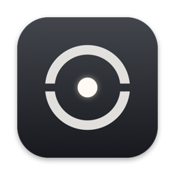
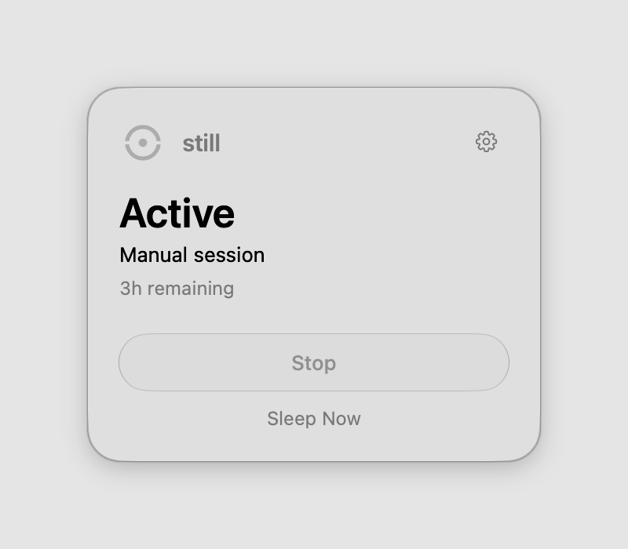

<p align="center">
  
</p>

<h1 align="center">still</h1>

<p align="center"><strong>Keep going, even when your MacBook closes.</strong></p>

<p align="center">
  Still is a lightweight native macOS menu bar utility that helps selected streaming sessions<br>
  and long-running tasks continue while your MacBook is closed.
</p>

<p align="center">
  <picture>
    <source media="(prefers-color-scheme: dark)" srcset="assets/screenshot-dark.png">
    
  </picture>
</p>

## Download

A notarized release is not available yet. Until it is, build Still from source; it takes about a minute. See [Build from source](#build-from-source).

Releases will appear on the [Releases page](../../releases) once the app is signed with a Developer ID and notarized by Apple.

## Features

- **Streaming continuity.** Detects Safari audio playback and keeps your Mac awake while the lid is closed. If WebKit pauses playback on the lid transition, Still can send a single Play key press to resume it.
- **AI coding-agent sessions.** Stays active while [Claude Code](https://claude.com/claude-code) or [Codex](https://github.com/openai/codex) is writing to its local session files.
- **Manual mode.** One click to keep the Mac active, with a Safety Timeout (3 hours by default).
- **Safety Timeout.** Manual sessions end on their own. Automatic sessions have an 8-hour ceiling.
- **Battery and thermal safeguards.** Normal sleep is restored below a battery level you choose, under thermal pressure, and in Low Power Mode.
- **Native menu bar integration.** SwiftUI and Liquid Glass. The menu bar shows the mark and the name; the name can be hidden in Settings.
- **Local-first.** No network access, no accounts, no analytics.

Still does not guarantee that every app or streaming service keeps playing with the lid closed. It is tested with Safari and AirPlay.

## Installation

1. Build the app (see below) or download a notarized release when one is available.
2. Move `Still.app` to `/Applications`.
3. Open it. Still lives in the menu bar and has no Dock icon.
4. Click **Set Up** and approve the administrator prompt once.

## Requirements

- macOS 26 or later
- Apple silicon Mac (arm64)

## Permissions

| Permission | Why | Required |
| --- | --- | --- |
| Administrator (once) | Installs `/etc/sudoers.d/still`, which lets your user run exactly `pmset -a disablesleep 1` and `pmset -a disablesleep 0` without a password. Nothing else. | Yes |
| Accessibility | Only to press Play in Safari after the lid closes. Without it, Still works but does not resume playback. | No |
| Notifications | One quiet message when a Safety Timeout ends. | No |

## How it works

Still holds a power assertion and sets the system `SleepDisabled` flag with `pmset -a disablesleep`, which keeps a MacBook running with its lid closed. It reads the flag back after every change and reconciles it at launch, so a crash or force quit cannot leave your Mac stuck awake.

`disablesleep` is an undocumented `pmset` option. Apple does not officially guarantee it will keep working across macOS versions and hardware. If it stops working, Still fails safe: your Mac sleeps normally.

Activity detection:

- **Streaming:** public CoreAudio process objects identify Safari/WebKit audio output.
- **AI work:** FSEvents watch `~/.claude/projects` and `~/.codex/sessions`. A transcript write within 180 seconds counts as work. Still reads file timestamps only, never their contents.
- **Playback resume:** one synthesized Play/Pause media key through public `NSEvent`/`CGEvent` APIs. No private frameworks are used.

## Build from source

You need Xcode 26 (Swift 6.2).

```bash
git clone https://github.com/sachawicky/still.git
cd still
swift run StillCheck            # run the test harness
./Scripts/build-release.sh      # produces dist/Still.app
open dist/Still.app
```

The local build is ad-hoc signed with Hardened Runtime. macOS may ask you to re-grant Accessibility after each rebuild because the code identity changes.

## Safety

- Do not put a closed, actively running MacBook in a bag or any poorly ventilated space. A running Mac produces heat.
- Keep the Safety Timeout on. Use "until I turn it off" only when you are watching the Mac.
- Another utility may also change sleep settings. If Still reports that another app disabled sleep, use **Restore Normal Sleep**.
- To check the current state: `pmset -g | grep SleepDisabled` (`0` is normal).

## Uninstall

1. Quit Still from its menu. This restores normal sleep.
2. Confirm with `pmset -g | grep SleepDisabled`. If it shows `1`, run `sudo pmset -a disablesleep 0`.
3. Turn off **Open at login** in Still's settings.
4. In Settings, choose **Administrator access → Remove**, or run `sudo rm /etc/sudoers.d/still`.
5. Delete `/Applications/Still.app`.
6. Optional: `defaults delete app.still.macos`

## Contributing

Issues and pull requests are welcome. See [CONTRIBUTING.md](CONTRIBUTING.md). For security reports, see [SECURITY.md](SECURITY.md).

## License

[MIT](LICENSE) © 2026 Sacha Wicky

## Creator

Designed & developed by [Sacha Wicky](https://sachawicky.com).
